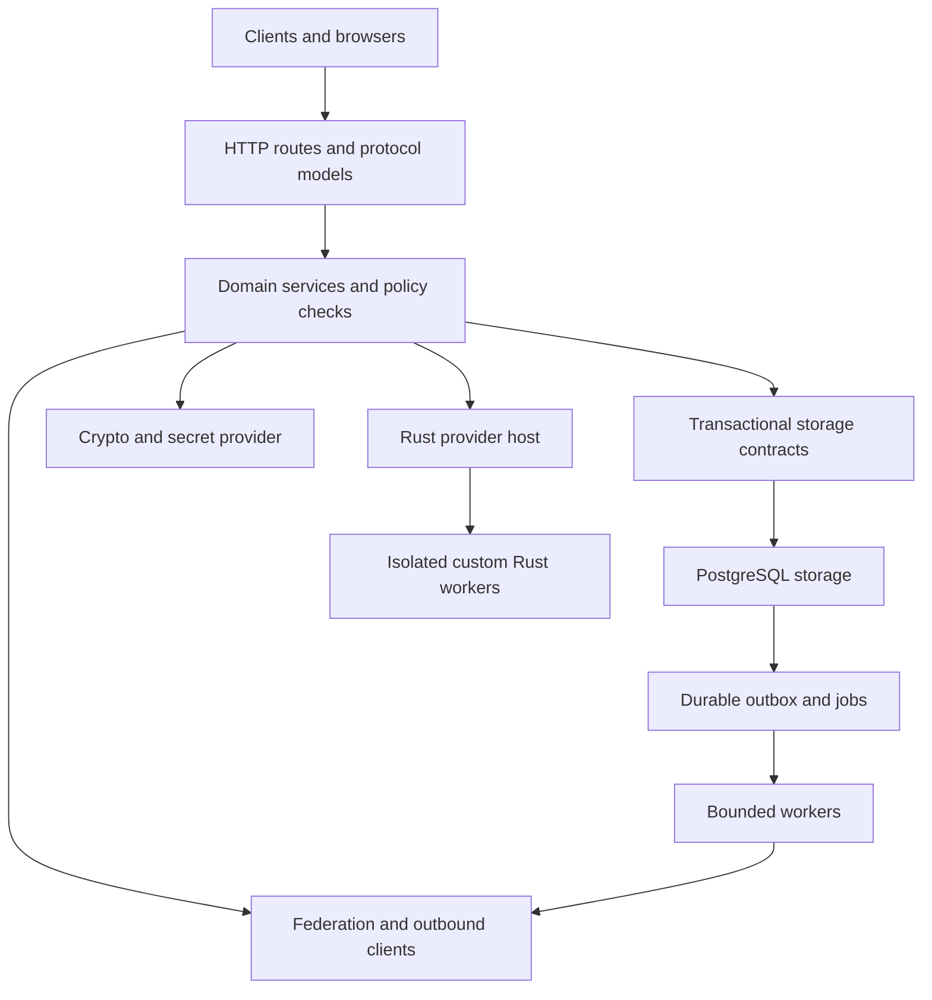

# rs-keycloak production plan

## Executive summary

rs-keycloak will be a complete, production-ready replacement for Keycloak's maintained features, built in Rust with PostgreSQL. The goal is for users to install it, migrate their realms and users, keep their existing application integrations, and manage authentication through a full web interface. Compatibility is defined by Keycloak's HTTP APIs and observable behavior, using version 26.8.1 as the first test target; legacy and deprecated features remain outside scope.

All application backend logic will run in Rust, including login flows, authorization, federation, jobs and custom providers. The functions currently supplied by Java-backed scripts will have Rust-backed alternatives; existing custom Java or JavaScript must be ported and checked before migration, because source-code compatibility would conflict with the Rust-only backend. Bun may support the web interface, but it will not run authentication or policy logic.

The product must feel fast in daily use, with short login and admin response times, quick startup and bounded resource use. The design uses async I/O, careful ownership, limited CPU work, efficient PostgreSQL queries and measured caching, following Google's Rust style guide. Delivery includes setup and migration tools, complete admin/account interfaces, single-node and multi-node deployments, safe upgrades, verified recovery and security testing. There is no MVP release: API parity, migration, reliability and performance are release gates, and no speed or compatibility claim is considered proven until tested.

## Goal and release boundary

Build a fully featured Rust server that satisfies the [Keycloak HTTP API compatibility contract](COMPATIBILITY.md) and stores authoritative state in PostgreSQL from the first release.

Legacy/deprecated features and execution of Java/JavaScript server code are excluded; the maintained customization capabilities those scripts provide must have Rust alternatives, and PostgreSQL is the only planned database.

Support both a simple single-app deployment and multiple Rust app instances behind a load balancer sharing a PostgreSQL primary; the release must qualify multi-node auth correctness and node failure, while database failover remains the database operator's responsibility.

Every delivery step is part of the full product; intermediate builds are development artifacts, not an MVP or a reduced production launch.

Planning assumptions are explicit: Keycloak `26.8.1`, a Linux deployment, and the load/recovery targets below; dependency pins and exact deployment sizing are set after the first evidence gates rather than guessed here.

The [architecture review](OPPORTUNITIES.md) records design decisions and their required proof; Rust provider migration replaces the Java bridge, and recovery must cover credentials and grants as well as sessions.

## Architecture

Use a modular Rust service that can be replicated as one deployment unit; custom Rust providers may use isolated Rust workers, with no second mandatory state store or generic ORM model that makes protocol behavior depend on database quirks.

Use Tokio, Axum/Tower, Serde and SQLx's PostgreSQL driver with typed queries and explicit wire models; use PostgreSQL 18 as the initial supported major, pin its reviewed patch/image for release tests, and require the same major in local integration tests. [Axum](https://docs.rs/axum/latest/axum/), [SQLx PostgreSQL driver](https://docs.rs/sqlx/latest/sqlx/postgres/index.html), [PostgreSQL 18](https://www.postgresql.org/docs/18/index.html).

Pin the Rust toolchain and all release dependencies, commit `Cargo.lock`, select the supported Rust version, and record license and security review for crypto, XML/SAML, WebAuthn, LDAP and template libraries before depending on them; do not add a server script engine or Java bridge.

Use established crypto and protocol libraries; do not build signature algorithms, XML canonicalization, WebAuthn verification or password hashing from scratch, and do not assume an OAuth client crate implements an authorization server.

| Proposed workspace unit | Responsibility and boundary |
| --- | --- |
| `crates/server` | Binary, CLI, configuration, startup checks, worker lifecycle and graceful shutdown |
| `crates/http` | Keycloak routes, wire models, errors, cookies, browser resources and proxy handling |
| `crates/domain` | Realm-scoped types, identity rules, auth flow states, policy evaluation and transaction contracts |
| `crates/protocols` | OIDC/OAuth, SAML, UMA, SCIM and other in-scope protocol adapters |
| `crates/crypto` | Narrow wrappers for reviewed crypto, credential verification, key selection and secret access |
| `crates/storage-postgres` | Typed queries, mappings, migrations, row locks, job claims and transaction implementation |
| `crates/integrations` | Broker/federation clients, mail, external callbacks and durable jobs |
| `crates/provider-sdk` and `crates/provider-host` | Versioned Rust customization contracts, signed provider registration, worker limits and migration bindings |
| `web` | Our own admin and account consoles: a React + Astro multi-page application built with Bun into static assets; every auth and data API is implemented in Rust |
| `compatibility` and `tests` | Reference lock, operation inventory, paired API/browser suites and failure/load fixtures |

Keep the domain free of Axum, SQLx rows and PostgreSQL error codes; HTTP models stay distinct from internal entities so omitted fields, default values and partial updates match Keycloak without weakening domain types.

Use named types for realm, user, client and session IDs; require a realm context at each tenant-scoped storage call and enforce admin permissions in services as well as routing middleware.

Model authentication and workflow execution as explicit persisted states with allowed transitions, deadlines and revisions; requests and workers must use the same rules so retry paths cannot bypass policy.

Follow the applicable [Google Rust style guide](https://google.github.io/styleguide/rustguide.html): leaf modules hold implementations, imports name their source module, named types express invariants, borrows replace unnecessary deep copies, and shared ownership is justified rather than added by default.

Prefer normal functions/types over custom macros, stable Rust, explicit error handling and documented public APIs; do not add unsafe code merely for a claimed speed gain, and review dependency/native-code boundaries separately.

CI runs `cargo fmt --check`, Clippy with reviewed project lints, and documentation checks; code review covers guide rules that tooling cannot enforce, including import layout where stable rustfmt lacks the needed option.

The guide's Chromium-only async/thread rules and Fuchsia-specific mutex rule do not apply to this standalone Tokio server; record project applicability and reviewed exceptions in `docs/rust-style.md` rather than claiming that rustfmt alone proves compliance.

## Rust-only application backend and web interface

Implement every auth, account, admin, policy, federation, job and extension host path in Rust; do not embed a JVM, JavaScript interpreter, Python service, Node backend or runtime compiler.

PostgreSQL, TLS proxies and browser code are infrastructure/client dependencies, not alternate implementations of the application backend; reviewed native crypto/OS dependencies remain subject to security and license review.

Use Bun for web dependency management, builds, tests and local live reload; ship static browser assets served by Rust by default, with optional Bun asset serving limited to the web interface. [Bun browser builds](https://bun.sh/docs/bundler).

The admin and account consoles are our own, not Keycloak's React apps: a multi-page application with Astro pages and React islands, built by Bun into static output that Rust serves, so no Node or Astro server runs in production. They cover every workflow of the pinned upstream consoles and aim to be better to use. The upstream consoles stay as compatibility clients in tests only, since they are the strictest check that our APIs match Keycloak's, and are not shipped.

The web interface has no direct database access, signing keys, trusted policy evaluation or separate session store; it uses the same Rust HTTP APIs as external clients, and native diagnostic/provider screens use a distinct versioned management surface.

Deliver complete admin and account workflows, localized and accessible login/recovery pages, theme branding, clear errors, large-list pagination and fast navigation; keep the pinned upstream consoles and their tests passing against our APIs even though the shipped UI is our own.

## Rust alternatives to server scripts

Keycloak scripts can supply authenticators, authorization policies and OIDC/SAML mappers, so removing the execution engine must not remove those capabilities; ship built-in Rust providers plus the custom Rust provider contract in [RUST-PROVIDERS.md](RUST-PROVIDERS.md). [Upstream extension hooks](https://www.keycloak.org/docs/latest/server_development/index.html#_script_providers).

Users can configure built-in providers through compatible APIs and the UI; custom logic is written in Rust, built in CI, installed as a signed artifact and bound to the same flow/policy/mapper position through an explicit migration map.

No arbitrary Java/JavaScript translation is promised: migration preflight finds each script/JAR, maps it to a tested Rust provider, and blocks cutover until every active dependency has a behavior match or the operator explicitly removes the feature.

Keep imported component IDs, ordering, settings and public claims where their semantics are preserved; raw JavaScript uploads and Java ABI loading are documented authoring exceptions, while application-facing auth and authorization results must remain compatible after migration.

## Setup as a complete replacement

Ship an OCI image, native Rust binary, a documented Compose deployment for one app plus PostgreSQL, and a multi-app deployment template with health probes, secret references, budgets and migration/backup jobs; pin release artifacts without inventing the user's hosting region or credentials.

Provide a guided setup flow: validate database/TLS/issuer settings, run explicit schema migrations, establish external key access, create a temporary local bootstrap admin through protected input, then require a permanent admin and remove bootstrap access.

Provide `migration inspect`, `migration plan`, `migration verify` and `migration cutover` commands with redacted reports covering source version, realms, users, clients, IDs, credentials, keys, federation, flows, policies, themes and all custom provider dependencies.

Rehearse an export/import into an isolated PostgreSQL target, compare counts and relationships, test representative logins and denied actions, verify Rust provider mappings, and run existing application/client tests before allowing cutover.

Preserve the public issuer/host, client IDs, redirect URLs, user subject IDs, claims and required verification keys where supported; application teams should not rewrite integrations to use rs-keycloak's own API.

Publish exactly what changes during migration: deprecated settings need remediation, custom Java/JavaScript needs a Rust port, FreeMarker themes need a supported template/branding port, and realm export requires re-login because live sessions are not exported.

Cutover freezes source writes, verifies the final import and external dependencies, switches traffic and watches public login/admin checks; rollback to the frozen source is valid only before target writes diverge, otherwise recovery requires reconciliation rather than a blind traffic switch.

Release qualification includes a fresh installation and a migration performed using only the shipped instructions and declared secrets, with no developer-only steps, placeholder providers or hidden missing features.

## Performance by design

Use Tokio for network I/O, with bounded requests, tasks, queues and database acquisition; never hold a synchronous mutex across `.await`, and keep unrelated realms off a global application lock.

Run password hashing, expensive crypto/XML work and blocking provider libraries behind CPU/memory admission limits outside async I/O workers; acquire capacity before spawning work and keep permits until work actually finishes even if the HTTP request times out. [Tokio CPU work](https://docs.rs/tokio/latest/tokio/task/fn.spawn_blocking.html).

Keep built-in providers in process, pass borrowed or compact typed values through hot paths, avoid repeated JSON parse/serialize cycles, and cap token/body size; use shared immutable snapshots only where sharing is needed, with profiling to justify allocation or ownership changes.

Compile flow/policy definitions into validated immutable execution plans keyed by config revision, cache parsed keys and discovery data with bounded lifetimes, and read authoritative revisions/revocation state from the primary before making security decisions.

Measure queries per operation and use joins/batched lookups to avoid N+1 reads; paginate large lists, reuse prepared statements and outbound connections, and keep PostgreSQL transactions short without relaxing durability or replay checks.

Use release builds with measured link-time optimization and profile-guided optimization only after reproducible end-to-end gains; retain symbols for profiling and do not require CPU-specific instructions absent from supported hosts.

Route-split web assets, cache immutable bundles, render loading/error states without blocking navigation and avoid repeated full-realm loads; measure the browser journey and HTTP response independently.

## Storage model and transaction rules

PostgreSQL is the source of truth for configuration, users, credentials, policies, sessions, tokens' replay/revocation state, authentication flows, consent, events, jobs and workflow progress; process caches are bounded and disposable.

Use one database per deployment with realm-qualified relations; do not split each realm into a separate database because master-realm administration, cross-table invariants and backups need one consistent transaction boundary.

| Entity group | Core records and constraints |
| --- | --- |
| Realm configuration | Realms, clients, scopes, mapper settings, flow definitions, required actions, key metadata and component/provider settings |
| Identity | Users, profile attributes, credentials, groups, roles, composites, memberships and grants; uniqueness and lookup normalization match the reference |
| Federation | Provider links, external IDs, sync cursors, trust configuration and organization membership; prevent cross-realm links with composite foreign keys |
| Sessions and flows | Authentication sessions, user/client sessions, offline sessions, consent, one-time codes, device/CIBA requests, action tokens, replay records and refresh families |
| Authorization | Resources, scopes, policies, permissions, tickets and dependency links; detect cycles and bound evaluation work |
| Operations | Schema history, object revisions, audit events, outbox jobs, job leases, workflow runs and bounded rate-limit/lockout state |

Preserve imported public IDs in `text` columns as opaque strings and generate new IDs in the compatible format; never expose internal sequences or require imported IDs to parse as UUIDs.

Store hot search, join and policy fields in typed columns, use `jsonb` for structured settings whose key order and duplicate keys have no wire meaning, and retain ordered attribute values in explicit ordered relations; add B-tree/GIN indexes only for measured query patterns.

Use `timestamptz` for stored instants, `boolean` for flags and `bytea` for digests/ciphertext, with explicit API epoch-unit conversions; use defined normalized lookup columns and collation rules so case matching and uniqueness match the reference rather than the host locale.

Multi-record actions use one transaction: code consumption plus session/token state; refresh rotation plus family state; password change plus revocation; role mutation plus revision; workflow progress plus next job; and admin mutation plus audit/outbox records.

Consume one-time data through conditional updates/deletes with checked row counts; a request that loses a race must not issue a token, reuse a recovery code, reset a password twice or grant a permission.

Match configured Keycloak refresh reuse and revocation behavior; test concurrent refresh and retry policies explicitly, and never widen a reuse window merely to hide a race.

Run network calls, XML/crypto work and password hashing outside write transactions; after expensive work, recheck credential/account revisions and policy state before committing the result.

Persist state before publishing a token or sending a callback; after a commit followed by a lost HTTP response, apply protocol-specific replay behavior instead of retrying a transaction blindly.

Use a transactional outbox for effects whose reference behavior permits asynchronous delivery, with bounded retries, deadlines and dead-letter state; preserve synchronous success/error semantics for federation writes and required callbacks, and never claim that a SQL commit atomically commits remote LDAP or HTTP work.

Never grant access based solely on a stale policy cache; use object/realm revisions, invalidate after commit, and recheck authoritative state for revocation-sensitive operations.

## PostgreSQL operating contract

Use SQLx `PgPool` connections to the writable primary for auth, policy, session and replay reads as well as writes; replicas must not serve decisions that can miss a revocation or recent credential change.

Require authenticated TLS with certificate/hostname verification outside explicit local development; use separate migration-owner, runtime and backup roles, a fixed schema/search path, and no superuser or DDL privileges for the runtime role.

Start per node with a 24-connection request pool and a 4-connection worker pool; reserve at least eight request slots for auth/revocation by limiting concurrent non-auth database work, and budget every node, listener, migration and operator connection against PostgreSQL's connection limit before scaling.

Use bounded per-realm admission and worker batches; start with a 250 ms pool-acquire timeout, 500 ms lock timeout, 2 s request-query timeout and 5 s idle-in-transaction timeout, all below the enclosing request deadline; maintenance has a separate explicit budget.

Keep `fsync`, `full_page_writes` and local synchronous commit enabled; production acceptance checks the server's durability settings and any synchronous-standby policy instead of assuming that a successful query implies a durable failover copy. [Durability and replication](https://www.postgresql.org/docs/18/warm-standby.html).

Default to `READ COMMITTED` with unique/composite foreign-key constraints and explicit row locking; use conditional writes for one-time data and `SERIALIZABLE` for multi-row rules that cannot be protected by a fixed lock set. [Isolation](https://www.postgresql.org/docs/18/transaction-iso.html).

| Operation | Transaction design |
| --- | --- |
| Redeem code or recovery token | Conditional `UPDATE`/`DELETE ... RETURNING`, checking expiry, binding and consumed state in the same statement; issue a result only after commit |
| Rotate refresh family | Lock family/session rows, recheck policy and revisions, consume/update generation, store replacement state, commit before response |
| Change credentials or grants | Lock affected identity/config revision rows in a fixed order, write credentials/grants and security audit in one transaction, invalidate dependent state |
| Claim background work | `FOR UPDATE SKIP LOCKED` with bounded batches; persist lease owner, deadline and increasing claim generation; completion checks the same generation |
| List authorized resources | Apply permission predicates before pagination/counting, using the same snapshot for list/count when both are returned; never filter only after a page has been read |
| Enforce a multi-row invariant | Fixed-order locks where possible; otherwise a serializable transaction with a bounded whole-transaction retry and no external side effects |

Use database time for persisted expiry and leases; lock acquisition follows a documented order to reduce deadlocks, and worker lease expiry does not authorize duplicate non-idempotent external calls without reconciliation. [PostgreSQL locking](https://www.postgresql.org/docs/18/explicit-locking.html).

Retry SQLSTATE `40001` and `40P01` at most three total attempts with jitter inside the request deadline, only for transactions whose whole body can be safely repeated; a lost connection during commit is an unknown outcome and must use persisted operation identity or protocol replay behavior rather than a blind retry.

Define use-case transaction interfaces in the domain and implement them directly with PostgreSQL queries; retain one connection per transaction and avoid a generic multi-database abstraction, SQLite test substitute, or speculative second adapter.

Partition high-volume event tables by time when measured volume warrants it, index expiry scans, delete session/job data in bounded batches, and monitor autovacuum, dead tuples, transaction age, locks, pool waits, WAL archive lag and replication-slot retention.

On database loss, disk-full errors or primary changes, fail closed for security decisions, mark readiness failed, discard broken connections and revalidate writable-primary/schema state before serving; return a bounded failure rather than serving cached authorization indefinitely.

## Migrations, local tests and deployment boundaries

Use ordered, checksummed PostgreSQL migrations and update schema history in each transactional migration; reject corrupt history or an unsupported schema before readiness, and never migrate implicitly from `serve` or `db check`.

Coordinate maintenance through a fixed PostgreSQL advisory-lock key: app transactions acquire its shared transaction lock and check maintenance state, while `db migrate` takes its exclusive session lock on a dedicated connection and sets persisted maintenance state before DDL.

The lock excludes in-flight app transactions; a migration failure leaves maintenance state set for explicit recovery, and a dropped migrator connection releases the advisory lock without silently reopening traffic.

Keep ordinary DDL transactional; operations such as concurrent index creation use explicitly marked steps with catalog checks, resumable state and a verification step before schema history advances; test interruption of both kinds.

Take a verified recovery point before destructive migrations and use expand/contract schema changes; allow binary rollback only within its declared schema range, and treat PostgreSQL major upgrades as a separate database-operator procedure with rehearsal.

Use a disposable PostgreSQL 18 instance per integration-test job with a unique database and runtime role per test group; run public migrations and API fixtures, and use PostgreSQL for local development so transaction and collation behavior match production.

Provide both single-instance and multi-node deployments; a managed or self-hosted PostgreSQL operator owns primary selection, standby fencing and promotion, while rs-keycloak tests reconnect and ambiguous-commit behavior against that service.

Persist authentication continuations, replay state, lockouts, rate-limit windows, sessions and workflow progress in PostgreSQL so requests can move between nodes without losing security state; session affinity may improve cache hits but cannot be required for correctness.

Use authoritative database revisions for security-sensitive cache checks; `LISTEN/NOTIFY` carries only non-secret invalidation hints, with reconnect/poll fallback, and missed messages must never extend revoked access. [PostgreSQL notifications](https://www.postgresql.org/docs/18/sql-notify.html).

Make periodic maintenance safe through idempotent job identities and PostgreSQL leases; every claim has a generation and deadline, completion rejects stale generations, and an expired lease does not prove that an external side effect never occurred.

Track each ready node's binary/schema/provider capabilities; reject activation of features a serving node cannot run, and make new nodes prove compatible capabilities before readiness.

Node registrations use database-time leases; every operation checks the current capability/config generation, so a partitioned or resumed node cannot keep serving an obsolete provider set after its lease has expired.

Drain requests and workers during shutdown; qualify two-node operation with random request routing, node kills, delayed DB access, replay races, missing invalidations, provider crashes and restarted workers before production release.

`upgrade check` compares binary/schema/provider/config versions and selects either a tested rolling path or maintenance; expand-only compatible migrations may run through the maintenance gate with bounded waits, but destructive or incompatible changes require a stopped/drained deployment.

Test every declared mixed-version pair and keep the old provider/config revision available for in-flight flows; never infer rolling compatibility solely from a SemVer patch number, and do not claim that migration from Java Keycloak itself is a rolling update.

Database HA is not disaster backup, and an asynchronous standby can lose acknowledged writes; lossless failover claims require a qualified synchronous-standby setup, old-primary fencing, and fault tests.

## Security requirements

Threat-model the public auth, admin, account, federation, provisioning, import and recovery paths before building them; cover cross-realm access, confused-deputy flows, replay, downgrade, SSRF, XML attacks, account linking, session fixation and resource exhaustion.

Apply strict issuer, audience, client, redirect, nonce, PKCE, algorithm, key-use and lifetime checks; match maintained client policies and fail closed on ambiguous parsing or duplicate security parameters. [OAuth security BCP](https://www.rfc-editor.org/rfc/rfc9700.html).

Use established password hashing with per-credential parameters and bounded CPU/memory admission; verify supported imported hashes and rehash when policy requires it, without reviving deprecated algorithms silently.

Store only password hashes and one-way token digests where recovery is unnecessary; encrypt recoverable OTP seeds, signing private keys, client secrets and provider secrets with authenticated encryption and record non-secret key IDs.

Load root encryption keys and bootstrap credentials from an operator-provided secret source, never repo files, logs, command arguments, fixtures or release archives; any local secret mounts live in ignored `.secrets` directories, and backup recovery must retain the matching external keys.

Implement overlapping signing keys, JWKS cache behavior, rotation and emergency compromise handling; keep old verification keys only as long as required, and explain that offline JWT verifiers can accept an issued token until expiry unless their own revocation policy intervenes.

Require explicit HTTPS issuer/hostname configuration in production, trust forwarding headers only from configured proxies, constrain cookie scope and SameSite behavior, and enforce CSRF/CORS/CSP and redirect policy on browser and admin paths.

Constrain outbound provider, JWKS, metadata and webhook requests by scheme, address policy, redirects, timeout and response size; support explicitly allowed private LDAP/IdP hosts without opening arbitrary internal network access.

Disable XML external entities and bound XML depth, size and expansion; verify the exact signed SAML element and destination, and treat missing mature XML-signature support as a build blocker requiring a reviewed dependency decision.

Bound request bodies, fields, regex/policy evaluation, password work, sessions, device polling, per-realm work and background jobs; rate-limit with trusted client addresses and durable lockout state while avoiding global lockout attacks.

Use least-privilege admin scopes and audited impersonation; bootstrap must be local/explicit, single-use and safe under concurrent startup, with a documented lost-admin recovery path.

Sanitize logs and traces at their source, exclude bodies and token-bearing URLs, minimize personal data in audit records, and define retention/deletion behavior for events, expired sessions and user data.

## Operations, backup and migration

Ship a non-root OCI image and a native binary with immutable versions, resource limits, graceful shutdown and separate startup/liveness/readiness checks; the app does not mount PostgreSQL's data directory, and metrics/management endpoints stay off the public auth surface.

Provide a public CLI for `serve`, `config check`, `db migrate`, `db check`, `backup create`, `backup verify`, `restore`, `import`, `export`, `bootstrap-admin`, `migration inspect/plan/verify/cutover`, `provider install/verify`, `upgrade check` and `version`; secrets use protected input channels, and destructive operations require an explicit target and mode.

Export metrics for grant outcomes, auth latency, callback failures, pool pressure, database locks, archive/replay lag, backup age, disk space, job delay and key expiry; bound label cardinality and exclude user/token identifiers.

Use PostgreSQL physical base backups plus continuous WAL archiving for disaster recovery: self-hosted deployments use `pg_basebackup`, backup manifests and `pg_verifybackup`, while managed deployments use the provider's equivalent PITR interface; the qualification contract requires both a verified base backup and an unbroken WAL chain to the chosen recovery point. [PostgreSQL PITR](https://www.postgresql.org/docs/18/continuous-archiving.html), [base backups](https://www.postgresql.org/docs/18/app-pgbasebackup.html).

Verify a plain-format backup before compression/encryption, or unpack it into a protected isolated location for verification; manifest verification does not replace an actual PostgreSQL restore and replay test. [Backup verification](https://www.postgresql.org/docs/18/app-pgverifybackup.html).

The backup CLI invokes the configured database-operator interface using separate backup privileges; it must not copy database files through the app, implement its own WAL format, or grant runtime SQL credentials replication/superuser access.

Encrypt backup artifacts, store them off-host, and verify remote bytes and required WAL availability; record cluster identity, PostgreSQL major, timeline, recovery LSN/time, application/schema version and external key IDs without secret values.

Physical recovery restores a cluster, not an individual application database; always restore into an isolated cluster first and never overwrite unrelated databases on a shared server as part of an app restore.

Use an operator-selected off-host store rather than inventing a provider, region or bucket; backup qualification requires a configured destination, monitoring of the last recoverable point, and retained keys before production release.

Target a maximum five-minute archive data-loss window and thirty-minute database restoration at the agreed dataset size; include backup download, WAL replay and application checks in the drill, and do not confuse this infrastructure target with permission to reopen auth after losing security changes.

Retain complete base-backup/WAL dependency sets for the configured recovery window; failed uploads/listing/verification prevent retention deletion, and capacity alerts must fire before a full WAL/archive disk stalls the primary.

Restore in quarantine with public auth, mail, callbacks and jobs disabled; recover the matching keys, verify the schema and constraints, and test representative data through an isolated app instance.

Before cutover, fence the old app and database writer path, preserve the source recovery point, select one writable primary, rotate runtime access when needed and record the restored timeline; an advisory lock cannot fence two separate PostgreSQL clusters.

Invalidate restored sessions, one-time artifacts and pending security jobs, advance the recovery generation, and rotate/revoke signing material as needed; these steps alone do not make restored passwords, enabled accounts or grants safe.

Reopening auth requires proof that all acknowledged security changes through cutover are present; if WAL is missing or the chosen restore point predates a security change, keep restored realms quarantined until an independently trusted identity source or operator-approved account-by-account review revalidates credentials, enabled state and grants.

Do not reset credentials by emailing addresses from an unverified restore or accept an old password as proof of identity; where a trusted current state cannot be established, authentication stays closed, and the recovery report must state that the thirty-minute service recovery target was not met.

Document the residual lifetime of issued JWTs at offline consumers and duplicate external-work risks; test rejection of a pre-reset password, a deleted/disabled user, a removed role, revoked sessions and spent codes after both complete-WAL and data-loss restores.

For migration from Keycloak, preflight an export for deprecated settings, custom extensions, provider configuration, crypto formats and unsupported fields before changing the target; report every rejected item and preserve IDs and supported credentials.

Use full exports from a controlled source freeze, encrypted streams or protected transient input, and an isolated rehearsal; require re-login because Keycloak exports omit sessions and other live state. [Keycloak import/export limits](https://www.keycloak.org/server/importExport).

Cutover includes issuer/hostname and signing-key decisions, verified client flows, source freeze, rollback criteria and a read-only source recovery point; do not claim session continuity or rolling cutover that the export cannot provide.

## Verification and production gates

Start with the public CLI/API/browser boundary, then use focused unit, property and fuzz tests for rules that public tests cannot explore efficiently; no test should merely restate the implementation.

| Gate | Required evidence |
| --- | --- |
| Compatibility | Every in-scope operation/profile inventoried and verified; no unexplained differences, skipped required cases or success stubs; retained client/browser reports and documented code-authoring migration exceptions |
| Replacement setup | Fresh install and migrated Keycloak deployment work from shipped instructions; existing app flows pass, every active custom provider is mapped to tested Rust behavior, and cutover/rollback limits are verified |
| Rust providers | All four script hook families have Rust alternatives; provider lifecycle, migration, sandbox, timeout, mixed-version and failure tests pass |
| Multi-node operation | Random routing, session continuity, atomic replay handling, global lockouts, node loss, job lease fencing, cache staleness and declared rolling upgrades pass |
| Authorization | Cross-realm and privilege-denial matrix for every protected resource; policy changes and revocation reflected in subsequent requests |
| Protocol safety | Independent OIDC conformance tests for advertised profiles; code/token/recovery races, restart replay prevention, clock/skew bounds, key rotation, malicious SAML/XML, broker linking and malformed input suites |
| Persistence | App/database process-kill recovery, primary reconnect, ambiguous commits, deadlocks, serialization retries, pool exhaustion, disk-full/read-only faults, interrupted imports and failed migration rollback through the CLI/API |
| Recovery | Base backup plus WAL replay into a fresh cluster with declared keys; no revived sessions/codes/passwords/grants, no unwanted side effects, measured database RPO/RTO and explicit auth-quarantine status |
| Performance | Reproducible HTTP/browser/startup/resource measurements against the budgets below, including providers, backup/checkpoints and noisy realms; no unbounded queues, memory growth or WAL growth |
| Supply chain | Dependency/license review, SBOM, vulnerability checks, signed artifacts/provenance and reproducible pinned inputs |
| Security review | Independent review and penetration testing of auth/admin/federation/recovery; no unresolved critical/high findings or known auth bypasses |
| Operations | Upgrade/downgrade rules, on-call diagnostics, key compromise, lost-admin, capacity and disaster runbooks exercised |

Proposed initial load profile: 100 realms, 100,000 total users, 100,000 active sessions and 1,000 clients; allocate 4 dedicated CPU cores/8 GiB RAM to the app and 4 cores/8 GiB RAM plus local SSD to PostgreSQL, record network latency, and measure external provider latency separately.

Retain a sustained 200 requests/second acceptance workload: 10% password logins, 50% refresh, 30% userinfo/introspection and 10% admin reads/writes, split equally between reads and writes; measure saturation separately rather than treating 200 requests/second as a throughput ceiling.

| Measurement | Release budget at the acceptance load |
| --- | --- |
| Non-password token/userinfo/introspection | p95 at most 50 ms; p99 at most 150 ms |
| Small admin reads, at most 100 returned rows | p95 at most 100 ms; p99 at most 250 ms |
| Password login, local credentials | p95 at most 500 ms; p99 at most 1 s, at the same hash parameters as the reference |
| Built-in login page response | p95 at most 100 ms, excluding remote provider or mail delivery time |
| Ready after process start | At most 2 s with a reachable database and current schema; report cold/warm storage separately |
| Default app resources | At most 128 MiB idle RSS and 512 MiB peak at acceptance load, including hashing but excluding PostgreSQL and optional custom-provider workers |
| Browser interaction | p75 INP at most 200 ms and LCP at most 2.5 s on the fixed browser/device/network profile recorded in CI |
| Errors | Fewer than 0.1% unexpected 5xx responses; overload rejections counted and reported separately |

Record the credential algorithm and all cost parameters, session-touch/write frequency, audit volume, per-realm skew, DB latency and query counts; do not improve a benchmark by weakening hashing, durability, policy, claim size or replay checks.

Freeze the hash/timeout/policy settings from the paired reference fixture, enable matched success/failure audit recording, and run both uniform realm traffic and a skewed case sending 80% of traffic to one realm; retain per-operation durable write counts in the benchmark report.

Repeat with custom Rust providers on 10% of login and token paths, with bounded input and declared worker budgets; require at most 10 ms p95 warm-worker overhead for a pure condition/mapper fixture and report cold starts and all worker memory separately.

Compare rs-keycloak against the pinned, optimized Keycloak release on identical total CPU/RAM, PostgreSQL data, feature settings and hash costs; publish max sustainable throughput, p50/p95/p99, CPU, total RSS including custom workers, startup and requests per core with repeated runs and variance.

Require no material latency or throughput regression on the fixed core workload versus the baseline, with a 5% tolerance for measurement noise, in addition to the absolute budgets; claims of a specific speedup need measured evidence and cannot be inferred from Rust.

Run a 24-hour soak, a 2x burst, import/export and backup under traffic, lockout attacks and large-realm searches; report p99, accepted/rejected load, password parameters, CPU/RSS, dataset shape and disk behavior rather than hiding expensive paths in averages.

These are proposed acceptance targets, not benchmark results or a capacity promise; failure requires engineering or a reviewed capacity decision, and must not silently reduce API scope or durability.

## Delivery steps

| Step | Depends on | Work | Exit gate |
| --- | --- | --- | --- |
| 0. Freeze the contract | None | Pin reference source/image/clients and PostgreSQL image; enumerate HTTP routes, feature versions and Rust replacement hooks; record runtime/legacy exclusions; build fixtures/threat model; audit SAML/crypto/FIPS dependencies | Every HTTP surface classified, required customization mapped, baseline performance captured, real reference entry points exercised |
| 1. Prove storage and safety boundaries | 0 | Build PostgreSQL schema/queries, pool/admission limits, locking/migrations, transaction contracts, secret loading and PITR/restore | Public restart, race, deadlock, connection-loss, disk-full, failed-migration and quarantined-recovery tests pass |
| 2. Identity and admin foundations | 1 | Implement realm/client/user/group/role/profile/session/key models, admin permissions, flow definitions, audit and master-realm boundaries | Admin client scenarios and tenant-denial tests pass against the reference for completed rows |
| 3. Complete authentication and account flows | 2 | Browser flows, credentials/MFA/passkeys, recovery, modern OAuth grants, sessions, rotation, consent, Bun web tooling, account/console integration and Rust authenticator SDK | Complete login/refresh/logout/recovery journeys and replay tests pass; custom Rust login works through the API/UI |
| 4. Complete remaining API families | 2, 3 | SAML, UMA/policy engine, federation/brokers, organizations, SCIM, workflows, client registration, Docker, maintained opt-in APIs and Rust policy/mapper providers | Full operation inventory passes including feature dependencies, failure paths and custom provider effects |
| 5. Replacement deployment and operations | 1–4 | Complete setup and provider migration, import/export/cutover, off-host backups, multi-node/rolling qualification, resource limits, monitoring and runbooks | Fresh install, rehearsed migration, failover and recovery meet their gates; no unmapped active custom behavior |
| 6. Production qualification | 0–5 | Full paired suite, load/soak/fault tests, independent security review, supply-chain checks and release rehearsal | Every production gate passes; publish compatibility, exclusions, capacity and recovery evidence |

Do not postpone backups, audit, transaction correctness or negative authorization tests until hardening; add each invariant with the feature and repeat the complete qualification in step 6.

The critical path includes reference-contract work, mature SAML/crypto dependencies, durable auth state, full policy/federation behavior and independent security review; a credible calendar estimate needs the step-0 inventory and staffing, not an assumed MVP schedule.

## Release and maintenance

Use [versionedcommits](https://github.com/mikkel3000/versionedcommits) for release metadata with `@major`, `@minor` or `@patch` on a new line; preserve free-form commit titles, and tie compatibility-breaking changes to an explicit major release note.

Configure the versionedcommits release workflow when CI is created, validate its output through the CLI in a disposable Git fixture, and pin the reviewed workflow revision; release publication must depend on production gates and may not bypass them through automatic tagging.

Publish the binary/image, SBOM, provenance, migration notes, compatible Keycloak version, exact feature profiles, exclusions, capacity report and restore instructions together; keep database schema and Keycloak contract versions separate from the project's SemVer.

Define security reporting, patch ownership and response targets before launch; review upstream Keycloak fixes continuously and keep pinned baseline fixtures even when adding a newer compatibility profile.

All implementation gates remain open: this change supplies the plan and scope only, with no runtime, benchmark, conformance or recovery results claimed.
